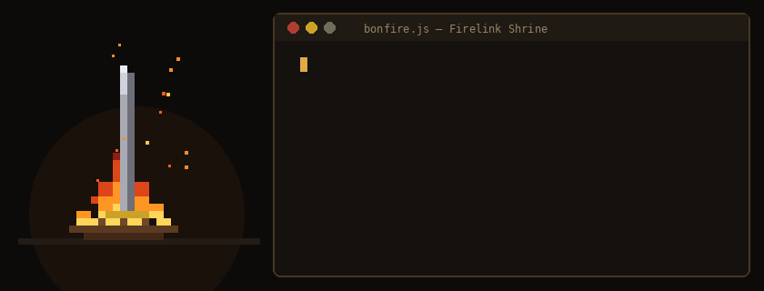

<h1 align ="center"> João Frazão Zanon</h1>

  <b>Estudante de Engenharia de Software</b>

---

### Vamos nos conectar?

Estou aberto a trocar conhecimentos, colaborar em projetos e aprender com outras pessoas da área de tecnologia. Seja para falar sobre desenvolvimento, arquitetura de software ou novas ideias, sinta-se à vontade para me mandar uma mensagem!

  

---

## Sobre Mim

- Atualmente cursando **Engenharia de Software** quero me aprofundar e evoluir na área para futuramente engraçar na área de jogos, mas também penso em futuramente entrar na area artistica de jogos sendo com sons, musicas, desenhos é algo que me agrada e queria poder fazer
- Gosto bastante de mexer com codigos e resolver problemas, e mexer com mods dentro de jogos e poder mexer com eles.
- Focado na área de desenvolvimento e criação e alteração (mods) com jogos e artes visuais.

---

## Linguagens e tecnologias

  

### Stack de Conhecimentos:

- **Linguagens:** C, JavaScript;
- **Web / Frontend:** HTML5, CSS3;
- **Ferramentas & Versionamento:** Git, GitHub;

---

## Game Zone:

  

---

  <i>"Cada projeto uma oportunidade de criar e transformar ideias em realidade!"</i>

